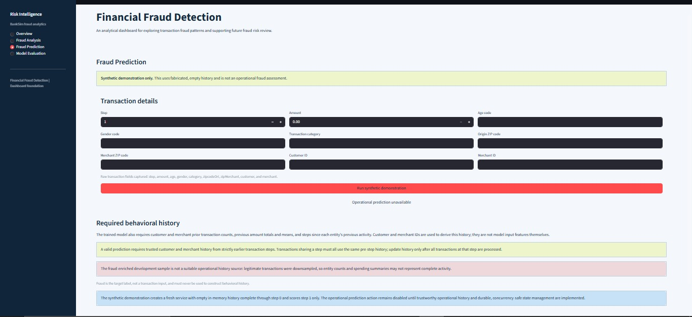

# Financial Fraud Detection Using Machine Learning
A machine learning project that analyzes BankSim transactions, engineers customer and merchant behavioral features, compares classification models, and presents results in an interactive Streamlit dashboard.

Project status: The data preparation and model evaluation pipeline, prediction service, automated tests, and dashboard are implemented. The dashboard's fraud-prediction page is a synthetic demonstration only; operational fraud prediction is not enabled.

## Dashboard Preview

The dashboard contains four pages for exploring the project and its results.

### Overview


### Fraud Analysis


### Model Evaluation


### Fraud Prediction



## Table of Contents

- [Project Overview](#project-overview)
- [Objectives](#objectives)
- [Dataset](#dataset)
- [Technology Stack](#technology-stack)
- [Project Structure](#project-structure)
- [Workflow](#workflow)
- [Feature Engineering and Leakage Prevention](#feature-engineering-and-leakage-prevention)
- [Machine Learning Models](#machine-learning-models)
- [Model Evaluation](#model-evaluation)
- [Prediction Service](#prediction-service)
- [Interactive Dashboard](#interactive-dashboard)
- [Automated Testing](#automated-testing)
- [Installation and Execution](#installation-and-execution)
- [Limitations](#limitations)
- [Future Improvements](#future-improvements)

## Project Overview
Financial transaction fraud detection is a classification problem: transaction attributes and historical behavior are used to estimate whether a transaction may be fraudulent.

This project uses the BankSim dataset to explore transaction patterns, derive customer and merchant behavioral features from earlier activity, train classification models, and evaluate their ability to distinguish fraudulent transactions from legitimate ones. It also includes a prediction service and a Streamlit dashboard.

### Key Features
Original dataset inspection and development-sample creation

Exploratory Data Analysis (EDA)

Customer and merchant behavioral feature engineering

Chronological training, validation, and test partitions

Data preprocessing

Logistic Regression, Random Forest, and XGBoost comparison

Validation-based model and decision-threshold selection

Held-out test evaluation

In-memory behavioral feature store

Model prediction service

Interactive Streamlit dashboard

Automated tests using Pytest

## Objectives

Analyze transaction data and explore fraud patterns.

Engineer behavioral features from prior customer and merchant activity.

Prevent temporal leakage during feature generation and evaluation.

Compare multiple classification algorithms.

Select a model and decision threshold using validation data.

Evaluate the selected model on a held-out test set.

Build a reusable prediction service and a dashboard for reviewing results.

Demonstrate the prediction interface with synthetic inputs without presenting it as an operational fraud system.

## Dataset

This project uses the BankSim dataset. The original dataset is not included in this repository; obtain a compatible copy separately.

Original Dataset

Description

Count

Total transactions

594,643

Fraudulent transactions

7,200

Legitimate transactions

587,443

Fraud prevalence

Approximately 1.21%

Development Sample

The 50,000-row development sample retains all 7,200 fraud records and samples 42,800 legitimate records using a fixed random seed.

Description

Count

Total sampled transactions

50,000

Fraudulent transactions

7,200

Legitimate transactions

42,800

Fraud prevalence

14.4%

Important sampling caveat: This is a fraud-enriched sample, not a naturally representative sample of the original transaction population. Sample-based fraud rates and evaluation metrics—particularly precision—may not reflect performance at the original fraud prevalence or in a real financial institution.

## Technology Stack

Technology

Purpose

Python

Main programming language

Pandas and NumPy

Data manipulation and numerical operations

Scikit-learn

Preprocessing, classification utilities, and evaluation

XGBoost

Gradient-boosted classification

Matplotlib and Seaborn

Data visualization

Plotly

Interactive visualization

Streamlit

Dashboard

Joblib

Saving and loading models and preprocessing artifacts

Pytest

Automated testing

Git and GitHub

Version control and source-code hosting

## Project Structure

The repository's main components are organized as follows. Some generated data, figures, reports, and model artifacts are created locally when the pipeline runs and may be excluded from version control.

Financial-Fraud-Detection/
├── app/
│   └── app.py
├── data/
│   ├── raw/
│   └── processed/
├── models/
├── notebooks/
│   └── 01_data_inspection.ipynb
├── outputs/
│   ├── figures/
│   ├── models/
│   └── reports/
├── src/
│   ├── create_sample.py
│   ├── eda.py
│   ├── evaluate_model.py
│   ├── feature_engineering.py
│   ├── feature_store.py
│   ├── inspect_dataset.py
│   ├── prediction_service.py
│   ├── prepare_data.py
│   ├── preprocessing.py
│   └── train_model.py
├── tests/
│   ├── test_feature_store.py
│   ├── test_prediction_dashboard.py
│   └── test_prediction_service.py
├── .gitignore
├── README.md
└── requirements.txt

## Workflow

Inspect the original dataset.

Create the fraud-enriched development sample.

Perform exploratory data analysis.

Engineer customer and merchant behavioral features.

Split transactions chronologically into training, validation, and test partitions.

Fit preprocessing on training data.

Train Logistic Regression, Random Forest, and XGBoost.

Compare candidate models using validation metrics.

Select the final model and decision threshold using validation data.

Evaluate the selected model on the held-out test partition.

Use the feature store and prediction service to manage historical features and scoring.

Display analysis and saved evaluation results in the Streamlit dashboard.

Run the automated test suite.

## Feature Engineering and Leakage Prevention

The project combines transaction attributes with historical customer and merchant behavior.

Examples of Behavioral Features

Customer's previous transaction count

Customer's previous transaction amount total and mean

Steps since the customer's previous activity

Merchant's previous transaction count

Merchant's previous transaction amount total and mean

Steps since the merchant's previous activity

Temporal Leakage Prevention

Behavioral features are computed from strictly earlier transaction steps.

Transactions at the same step use the same pre-step history snapshot.

Historical state is updated only after all transactions for that step have been processed.

Customer and merchant identifiers are used to derive behavioral features rather than being passed directly to the model as input features.

Fraud labels are not used to construct behavioral history.

The preprocessing pipeline is fitted on training data and then applied to validation and test data.

## Machine Learning Models

Logistic Regression

Used as a baseline classifier for estimating the probability that a transaction is fraudulent.

Random Forest

Uses an ensemble of decision trees to model nonlinear relationships in transaction data.

XGBoost

Uses gradient-boosted decision trees to learn complex patterns in transaction attributes and engineered behavioral features.

Model Selection

XGBoost was selected because it achieved the highest validation Average Precision among the evaluated candidates. Model and threshold selection used validation data; the held-out test set was kept separate for final evaluation.

## Model Evaluation

The selected XGBoost model produced the following results on the held-out test partition.

Test Metrics

Metric

Result

Average Precision (AP)

0.992662

ROC-AUC

0.998882

Precision

0.938322

Recall

0.966667

F1-score

0.952283

Validation-selected decision threshold

0.71875411

Confusion Matrix

Rows represent actual classes and columns represent predicted classes.

Actual / Predicted

Legitimate

Fraud

Legitimate

6,360

61

Fraud

32

928

On this test partition:

928 fraudulent transactions were correctly identified.

32 fraudulent transactions were missed.

61 legitimate transactions were incorrectly flagged as fraudulent.

6,360 legitimate transactions were correctly classified.

Interpretation caveat: These results describe the fraud-enriched development sample. They do not establish that the same metrics will be achieved on naturally distributed transactions. The validation-selected threshold should not be assumed optimal for every institution or operational setting.

## Prediction Service

The prediction service integrates the saved XGBoost model, preprocessing artifacts, and historical behavioral feature store. Its responsibilities include:

Validating transaction inputs

Generating behavioral features

Applying the fitted preprocessing pipeline

Calculating fraud probabilities

Applying the selected decision threshold

Checking model and preprocessing compatibility

Managing historical state during prediction

Historical state is committed only after successful scoring and validation. The feature store is currently in memory; it does not provide durable storage or thread-safe state management.

## Interactive Dashboard

The Streamlit dashboard contains four pages.

1. Overview

Summarizes the project workflow and selected-model evaluation results.

2. Fraud Analysis

Shows visualizations for transaction amounts, fraud patterns by category, fraud rates across transaction steps, recorded age codes, and customer and merchant activity. BankSim age values are categorical codes; they should not be interpreted as verified numerical ages.

3. Model Evaluation

Displays model comparison, validation metrics, and held-out test results from generated reports. This page presents saved results; it does not independently retrain or reevaluate the model.

4. Fraud Prediction

Provides a synthetic demonstration using fabricated transaction inputs and empty in-memory behavioral history. It is not an operational fraud assessment. Predictions from this page must not be used to make decisions about real transactions.

Operational prediction remains disabled because trusted transaction history, persistent and concurrency-safe state management, and production safeguards have not been implemented.

## Automated Testing

The tests cover behavioral feature generation, feature-store state management, prediction-service validation, preprocessing/model compatibility, probability and classification outputs, dashboard input validation, and dashboard error handling.

The test suite was run in a fresh virtual environment during development:

python -m pytest -q

Verified result at the time of this README revision: 87 passed. Run the tests again after changing code or dependencies to verify the current state.

## Installation and Execution

Prerequisites

Python 3.13 (the development environment used for verification)

Git

A compatible BankSim CSV file obtained separately

1. Clone the Repository

1. Clone the Repository

```powershell
git clone https://github.com/Shelake04/Financial-Fraud-Detection.git
cd Financial-Fraud-Detection
```

2. Create and Activate a Virtual Environment

On Windows PowerShell:

```powershell
python -m venv .venv
.\.venv\Scripts\Activate.ps1
```
If PowerShell blocks environment activation, use a terminal configuration you are permitted to run, or invoke the environment's Python directly as .\.venv\Scripts\python.exe.

3. Install Dependencies

```powershell
python -m pip install --upgrade pip
python -m pip install -r requirements.txt
```

4. Configure the Dataset Path

The original BankSim dataset is not stored in this repository. Set the BANKSIM_CSV environment variable to the full path of your downloaded CSV file in the current PowerShell session. For example:

```powershell
$env:BANKSIM_CSV = "D:\path\to\your\bs140513_032310.csv"
```
Replace the example path with the actual location of your dataset. Keep the original dataset out of version control.

5. Run the Data and Model Pipeline

From the repository root, run the scripts in this order:

```powershell
python src/inspect_dataset.py
python src/create_sample.py
python src/eda.py
python src/prepare_data.py
python src/train_model.py
python src/evaluate_model.py
```

These scripts inspect the source data, create the development sample, generate EDA outputs, prepare data, train and select the model, and evaluate it. The dashboard depends on the required generated reports and model/preprocessing artifacts, so prepare these artifacts before launching the application.

6. Run the Tests

```powershell
python -m pytest -q
```
7. Launch the Dashboard

```powershell
python -m streamlit run app/app.py
```
Open the local address printed in the terminal. Keep the terminal running while using the dashboard.

## Limitations

The development sample has an artificially elevated fraud prevalence.

Evaluation results may not generalize to naturally occurring financial transactions.

The prediction page uses synthetic inputs and empty in-memory behavioral history.

The feature store is not persistent or thread-safe.

A trusted, production-quality historical transaction source has not been integrated.

Production monitoring, audit logging, and operational safeguards remain future work.

The application is not ready for operational fraud decisions.

## Future Improvements

- Evaluate on data with representative fraud prevalence.
- Integrate a trusted transaction-history source.
- Implement persistent, concurrency-safe behavioral state management.
- Add data-quality and model-performance monitoring.
- Add drift detection and prediction auditing.
- Implement operational safeguards and a reproducible model training/deployment workflow.
- Explore Apache Kafka and PySpark Structured Streaming for transaction processing.