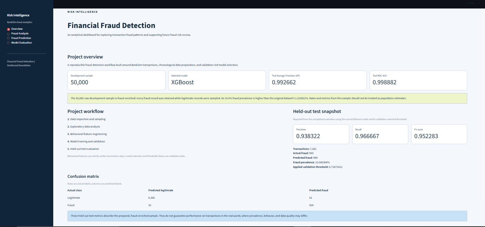
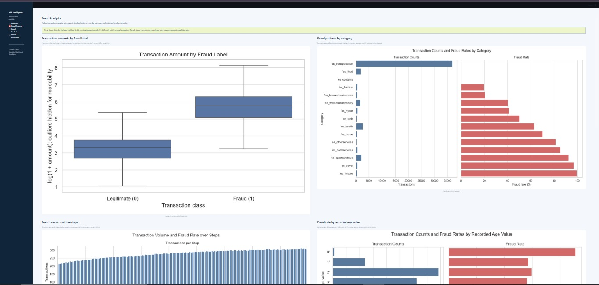
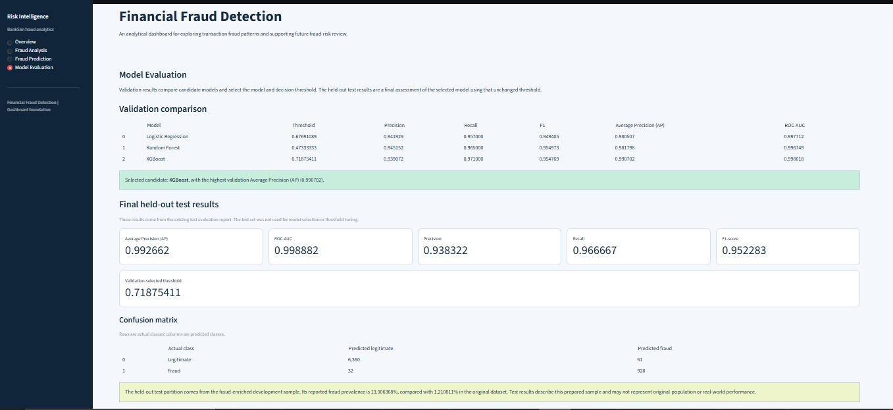

# Financial Fraud Detection Using Machine Learning

A machine learning-based financial fraud detection system built using
Python, XGBoost, and Streamlit. The project analyzes transaction patterns,
engineers customer and merchant behavioral features, compares multiple
classification models, and provides an interactive dashboard for exploring
fraud patterns and demonstrating predictions.


## Dashboard Preview

The Streamlit dashboard provides an interactive interface for exploring
transaction fraud patterns, reviewing model evaluation results, and
demonstrating fraud-risk predictions.

### Overview



### Fraud Analysis



### Model Evaluation



### Fraud Prediction


## Project Status

Core machine learning pipeline and dashboard implemented.

- Dataset inspection and sampling
- Exploratory Data Analysis (EDA)
- Behavioral feature engineering
- Data preprocessing and chronological splitting
- Model training and comparison
- Final test evaluation
- Historical transaction feature store
- Prediction service
- Interactive Streamlit dashboard
- Synthetic prediction demonstration
- Automated testing

Operational fraud prediction is not enabled. Trusted historical data,
persistent state management, and additional production safeguards are
required before operational use.

## Problem Statement

Financial transaction fraud can cause financial losses for customers
and financial institutions. Machine learning can help identify suspicious
transaction patterns and support fraud-risk review.

This project explores how transaction attributes and historical customer
and merchant behavior can be used to build and evaluate fraud classification
models.

## Objectives

- Analyze financial transaction data.
- Explore differences between legitimate and fraudulent transactions.
- Engineer behavioral features using previous transaction activity.
- Compare multiple machine learning classification algorithms.
- Evaluate model performance using appropriate classification metrics.
- Build an interactive dashboard for data analysis and model evaluation.
- Demonstrate predictions using the saved model and preprocessing pipeline.

## Dataset

The project uses the BankSim dataset.

Original dataset:
- Transactions: 594,643
- Fraudulent transactions: 7,200
- Legitimate transactions: 587,443
- Original fraud prevalence: approximately 1.21%

A 50,000-row development sample was created for this project. The sample
retains all 7,200 fraudulent transactions and samples 42,800 legitimate
transactions.

Consequently, fraud represents 14.4% of the development sample. This is
substantially higher than the original dataset's fraud prevalence.

**Important:** Metrics and fraud rates calculated from this enriched sample
must not be interpreted as estimates of performance or fraud prevalence
in naturally occurring financial transactions.

The original dataset is not included in the Git repository.

## Technology Stack

- Python
- Pandas
- NumPy
- Scikit-learn
- XGBoost
- SQLite
- Streamlit
- Matplotlib
- Seaborn
- Plotly
- Joblib
- Pytest
- Git and GitHub

## Project Workflow

1. Dataset inspection and sampling
2. Exploratory Data Analysis
3. Behavioral feature engineering
4. Data preprocessing
5. Chronological training, validation, and test splitting
6. Model training and comparison
7. Validation-based model selection and threshold selection
8. Final test evaluation
9. Prediction service development
10. Streamlit dashboard integration
11. Automated testing

## Machine Learning Models

Three classification algorithms were trained and compared:

- Logistic Regression
- Random Forest
- XGBoost

XGBoost was selected based on its highest validation Average Precision
among the evaluated models.

Model selection used validation data. The held-out test set was evaluated
separately after model selection.

## Final Test Results

The selected XGBoost model produced the following results on the held-out
test split:

| Metric | Result |
|---|---:|
| Average Precision (AP) | 0.992662 |
| ROC-AUC | 0.998882 |
| Precision | 0.938322 |
| Recall | 0.966667 |
| F1-score | 0.952283 |
| Decision threshold | 0.718754 |

### Confusion Matrix

| Actual / Predicted | Legitimate | Fraud |
|---|---:|---:|
| Legitimate | 6,360 | 61 |
| Fraud | 32 | 928 |

These results describe performance on the held-out portion of the
fraud-enriched development sample. They do not guarantee equivalent
performance on real-world financial transactions.

## Behavioral Feature Engineering

The model uses transaction attributes together with historical customer
and merchant behavior.

Examples include:

- Previous transaction counts
- Previous transaction amount totals
- Previous transaction amount means
- Steps since previous customer activity
- Steps since previous merchant activity

Historical features are calculated using strictly earlier transaction
steps. Transactions sharing a step use the same pre-step history snapshot.

Customer and merchant identifiers are used to derive behavioral features,
not as direct model input features.

Fraud labels are not used to construct behavioral history.

## Prediction Service

The prediction service integrates:

- The saved XGBoost model
- The saved preprocessing pipeline
- Historical behavioral feature generation
- Probability calculation
- Threshold-based classification
- Input and output validation

The service validates model and preprocessing compatibility before
performing predictions.

## Interactive Dashboard

The Streamlit dashboard provides four pages:

### Overview
Displays project information and model performance summaries.

### Fraud Analysis
Presents visualizations of transaction amounts, categories, time-based
patterns, age codes, and customer and merchant activity.

### Fraud Prediction
Provides a synthetic transaction demonstration using the saved model.

### Model Evaluation
Displays validation metrics, final test metrics, and the selected model.

**The prediction interface is a synthetic demonstration, not an operational
fraud detection service.** It uses fabricated input and empty in-memory
history. Operational prediction remains disabled because trustworthy
historical data and production-ready state management have not been
implemented.

## Automated Testing

The project contains automated tests for:

- Historical behavioral feature generation
- Transaction history state management
- Prediction service validation
- Preprocessing and model compatibility
- Probability and classification outputs
- Dashboard input validation
- Dashboard error handling

Latest recorded full test-suite result:

**87 tests passed.**

Run the tests from the project root:

```bash
python -m pytest tests/ -v


```

## Installation and Execution

### 1. Clone the repository

```bash
git clone https://github.com/Shelake04/Financial-Fraud-Detection.git
cd Financial-Fraud-Detection
```

### 2. Create a virtual environment

```bash
python -m venv .venv
```

Activate it in Windows PowerShell:

```powershell
.\.venv\Scripts\Activate.ps1
```

### 3. Install dependencies

```bash
python -m pip install -r requirements.txt
```

### 4. Prepare the required artifacts

The prediction service and dashboard require the saved model and preprocessing artifacts. These generated files are excluded from the repository.

Follow the project workflow to prepare the dataset, generate the prepared data, fit the preprocessing pipeline, and train the models.

Use a compatible BankSim dataset that you have obtained and stored locally.

### 5. Run the dashboard

```bash
python -m streamlit run app/app.py
```

Open the local address displayed in the terminal.

## Project Limitations

- The development sample has an artificially elevated fraud prevalence.
- Evaluation metrics may not generalize to naturally occurring financial transactions.
- The dashboard demonstration uses fabricated transaction data.
- The demonstration starts with empty behavioral history.
- The feature store is in-memory and is not thread-safe or persistent.
- Trusted historical data and additional safeguards are required before operational use.
- The application is not currently ready for operational fraud decisions.

## Future Improvements

- Integrate a trustworthy transaction history source.
- Implement persistent and concurrency-safe behavioral state management.
- Evaluate the model on an appropriately distributed dataset.
- Add data-quality monitoring and model-performance monitoring.
- Implement prediction auditing and operational safeguards.
- Explore Apache Kafka and PySpark Structured Streaming for transaction processing.

## Author

Developed as a machine learning project focused on financial fraud detection, behavioral feature engineering, model evaluation, and interactive analytics.
